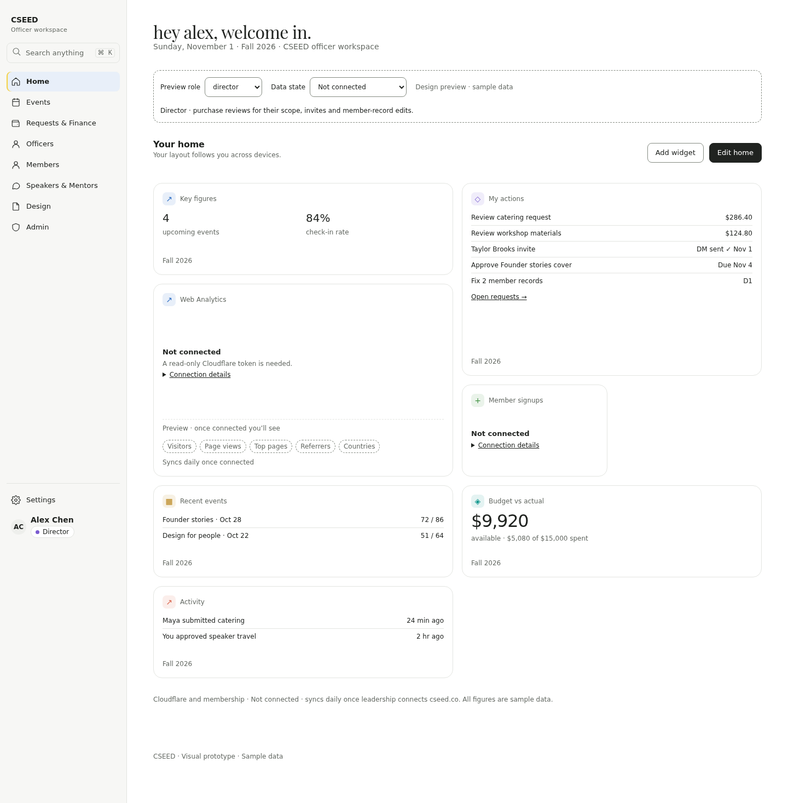
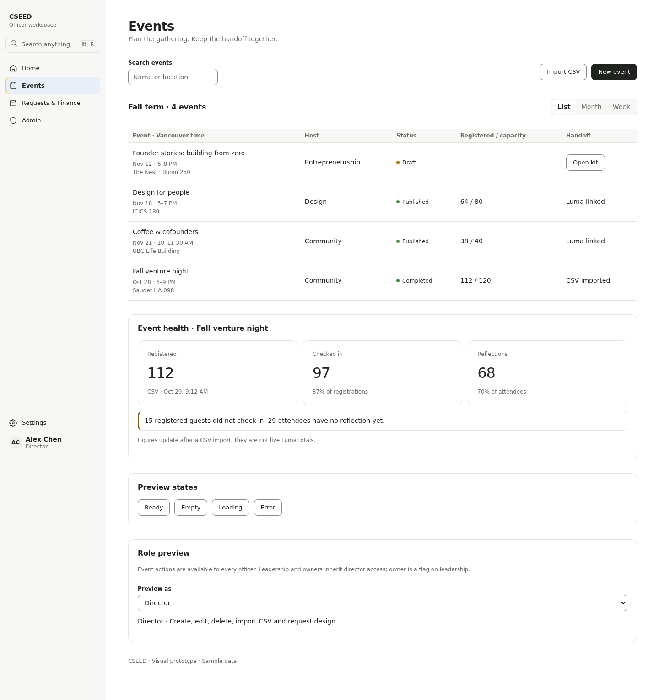
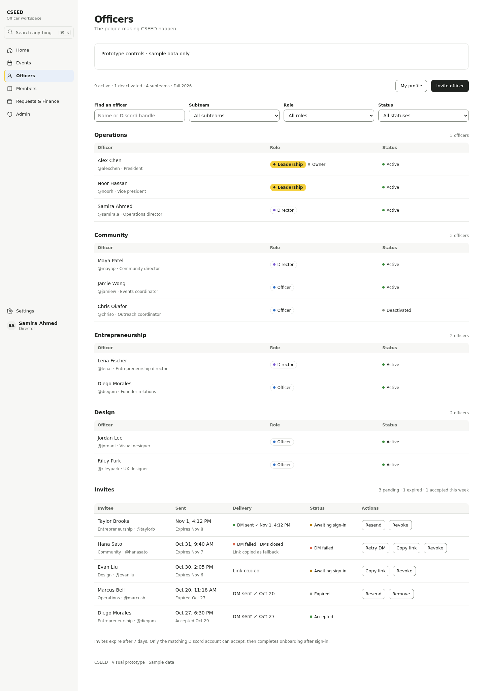
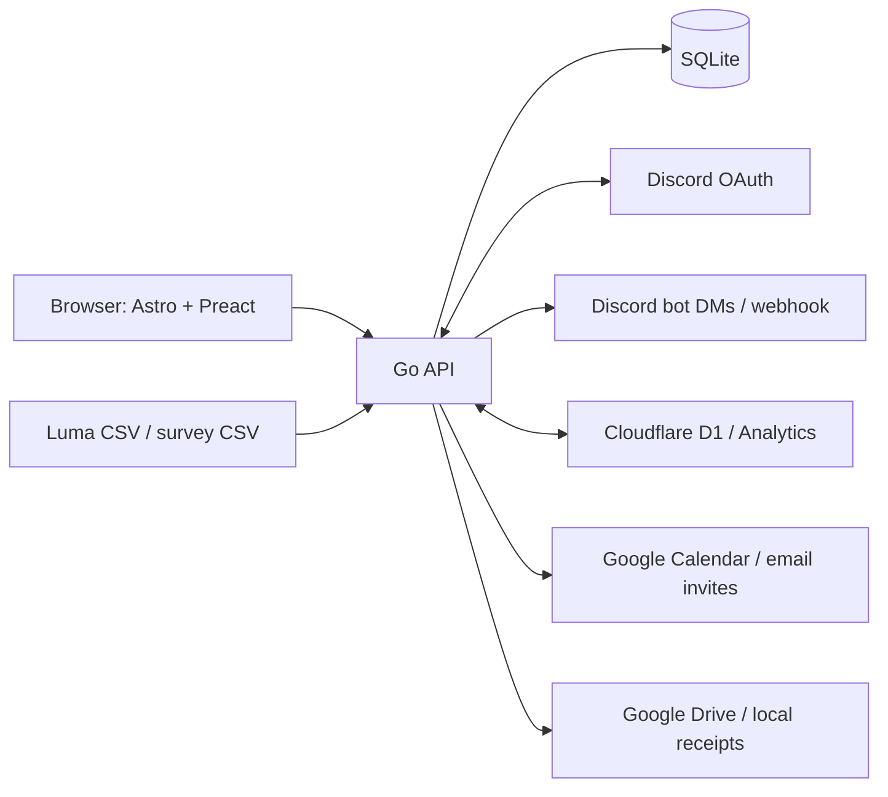

<a id="top"></a>
<div align="center">
  <picture>
    <source media="(prefers-color-scheme: dark)" srcset="web/public/images/cseed-logo-white.png">
    
  </picture>
  <h1>CSEED Officer Dashboard</h1>
  <p>Events, people, purchases, and club finances in one place.</p>

[](https://github.com/cseed-org/officer-dashboard/actions/workflows/ci.yml)
[](LICENSE)
[](server/go.mod)
[](package.json)
[](web/package.json)
[](https://github.com/cseed-org/officer-dashboard/commits/main)
[](CONTRIBUTING.md)

[Docs](docs/README.md) · [Contributing](CONTRIBUTING.md) · [Security](SECURITY.md) · [Report a bug](https://github.com/cseed-org/officer-dashboard/issues/new)
</div>

## Table of contents

[Features](#features) · [Screenshots](#screenshots) · [Architecture](#architecture) · [Quick start](#quick-start) · [Configuration](#configuration) · [Testing and checks](#testing-and-checks) · [Project layout](#project-layout) · [Documentation](#documentation) · [Contributing](#contributing) · [Security](#security) · [License](#license)

## Features

V0.3 uses Discord sign-in with leadership, director, and officer roles, plus explicit owner access.

| Page | What you can do |
| --- | --- |
| Home | Arrange widgets; see club activity and Cloudflare analytics connection states. |
| Officers / onboarding | Invite via Discord DM, complete profiles, manage subteams, choose calendar delivery. |
| Members | Search the local D1 mirror, edit member records, export CSV, and sync. |
| Events | Plan events, generate a Luma handoff kit, import registrations/check-ins and reflections, track metrics. |
| Finance | Submit and review purchase requests, attach receipts, track budgets, and view double-entry financial reports. |
| Speakers & Mentors | Maintain contacts and log outreach. |
| Design Requests | Track work on a Kanban board with assignments, comments, files, and approval. |
| Officers / Settings | Manage access, tokens, audit history, preferences, and calendar connections. |

> [!NOTE]
> Notion event links are placeholders; see the [integration status](docs/notion-integration.md).

[Back to top](#top)

## Screenshots

Existing V0.3 design captures; GitHub chooses the light or dark version to match your theme.

<picture>
  <source media="(prefers-color-scheme: dark)" srcset="web/design/shots/home-v03-1440-dark.png">
  
</picture>

<details>
<summary>Events and officers</summary>

<picture>
  <source media="(prefers-color-scheme: dark)" srcset="web/design/shots/events-v03-1440-dark.png">
  
</picture>
<picture>
  <source media="(prefers-color-scheme: dark)" srcset="web/design/shots/officers-v03-1440-dark.png">
  
</picture>
</details>

[Back to top](#top)

## Architecture



The Go server serves the static front end and JSON API from one origin. SQLite is the primary database; D1 supplies the membership mirror. Run on a Raspberry Pi or a single container with durable replication. See [architecture](docs/architecture.md) and [deployment](docs/deployment.md).

[Back to top](#top)

## Quick start

Install Go 1.24+, a C compiler for SQLite/cgo, Make, and Node ≥22.23.4 (from `package.json`; this repo has no `.nvmrc`). From the repository root:

```sh
(cd web && npm ci && npm run build)
cd server
make dev
```

Open <http://localhost:8090/auth/dev?as=director> or <http://localhost:8090/auth/dev?as=officer>.

> [!IMPORTANT]
> `make dev` resets the sample database at `server/data/dev.db`. The dev login requires both a `-tags dev` build and `DEV_AUTH=1`; production builds have no `/auth/dev` route.

See [development](docs/development.md) for live front-end development, seeding, and Playwright.

[Back to top](#top)

## Configuration

| Variable | Purpose / default |
| --- | --- |
| `ADDR`, `DB_PATH` | Listen on `:8090`; database `./data/dashboard.db`. |
| `APP_URL` | Public origin for OAuth, cookies, and notification links. |
| `DISCORD_CLIENT_ID`, `DISCORD_CLIENT_SECRET` | Discord OAuth credentials. |
| `BOOTSTRAP_OWNER_DISCORD_ID` | Provision the initial owner while no owner exists. |
| `DISCORD_BOT_TOKEN` | Officer invitation DMs. |
| `GOOGLE_SERVICE_ACCOUNT_JSON`, `DRIVE_ROOT_FOLDER_ID` | Google Drive receipt storage. |
| `RECEIPTS_DIR` | Local receipt storage alternative. |
| `CLOUDFLARE_API_TOKEN`, `CLOUDFLARE_ACCOUNT_ID`, `D1_DATABASE_ID` | Membership sync and analytics integration. |

All variables, aliases, defaults, and optional calendar settings: [configuration reference](docs/configuration.md).

[Back to top](#top)

## Testing and checks

Run from the repository root:

| Check | Command |
| --- | --- |
| Go vet and tests, including dev login | `cd server && make vet && make test` |
| API contracts | `npm ci && npm run contract-check` |
| Web build and types | `cd web && npm ci && npm run build && npm run check` |
| Playwright (local, seeded backend required) | `cd web && API_ORIGIN=http://127.0.0.1:8090 npm run test:e2e` |

[CI](.github/workflows/ci.yml) runs Go, contract, and web jobs on PRs and pushes to `main`. Playwright runs locally. [Test details](docs/development.md).

[Back to top](#top)

## Project layout

| Path | Purpose |
| --- | --- |
| [server/](server/README.md) | Go API, accounting engine, embedded SQLite migrations, deployment assets. |
| [web/](web/README.md) | Static Astro + Preact UI, design references, Playwright tests. |
| [src/core/contracts.ts](src/core/contracts.ts) | Canonical zod API schemas; enums in `src/core/domain.ts`. |
| [web/src/lib/contracts.ts](web/src/lib/contracts.ts) | Front-end contract schemas. |
| [scripts/contract-check.mjs](scripts/contract-check.mjs) | Seed a temporary Go server and validate API contracts. |
| [docs/](docs/README.md) | Guides and API reference. |

The original TypeScript / Cloudflare Workers / D1 application is in git history before the v1-cleanup PR. The design follows [cseed.co](https://cseed.co): paper and ink, Playfair Display, Poppins, and Anonymous Pro.

[Back to top](#top)

## Documentation

Start at the [docs index](docs/README.md), including [API](docs/api.md), [permissions](docs/roles-and-permissions.md), [integrations](docs/integrations.md), and [accounting](docs/accounting.md).

> [!WARNING]
> Accounting reports are preparatory rollups, not complete tax filings. CPA review is required before keeping real books or preparing filings.

[Back to top](#top)

## Contributing

Read [CONTRIBUTING.md](CONTRIBUTING.md) and the [Code of Conduct](CODE_OF_CONDUCT.md). For usage help, see [SUPPORT.md](SUPPORT.md).

[Back to top](#top)

## Security

Follow [SECURITY.md](SECURITY.md) to report vulnerabilities privately. Keep deployment credentials in the server environment or secret store.

[Back to top](#top)

## License

Code: Apache-2.0. The CSEED name and logo are not licensed — see [TRADEMARKS.md](TRADEMARKS.md).
See [LICENSE](LICENSE) and [NOTICE](NOTICE).

[Back to top](#top)
