# Home calendar

The Calendar widget combines club events (including Luma-linked events) and open
design-request deadlines. It appears in the default Home layout and can be added
to existing layouts through **Edit home → Add widget**. The default keeps Links,
Recent events and every other dashboard widget. Calendar starts at 4×2 between
the stat tiles and Recent events/Budget, adding two full-width rows so the desktop
grid stays a complete 4×7 rectangle. Widgets added from the gallery start at 2×2.
Drag a resize grip or use Shift+arrow keys to move between Calendar’s 2×1, 2×2
and 4×2 sizes.

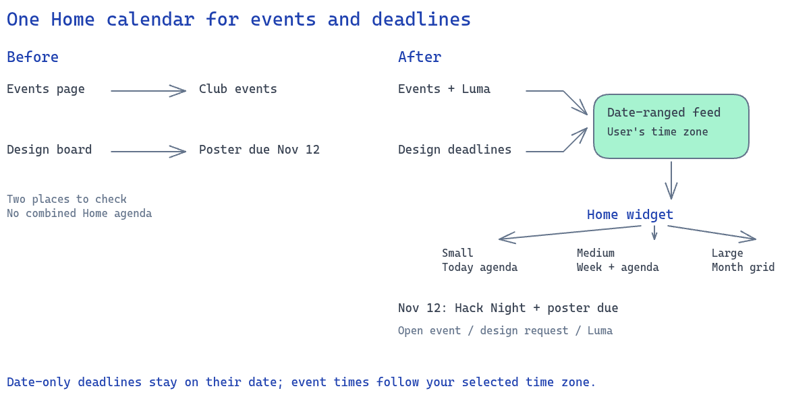

## Views and options

| Size | Automatic view |
| --- | --- |
| 2×1 | One-day agenda |
| 2×2 | Week strip and agenda |
| 4×2 | Month grid |

Options saves view, sources, colour grouping and weekend visibility to the signed-in
officer's account. Small widgets always use an agenda; other sizes allow explicit
agenda, week or month views. Toggle sources directly in the legend; calendar icons mark blue club events and pen
icons mark amber design deadlines. Legend changes save immediately. Hover or focus
a month/week chip to see its time, location, source, detail link and Luma link.
Timed chips include a compact start time (for example, **6p Hack Night**). Each day
shows two chips plus **+N more**; select that overflow to open the full date agenda.
Event and design links open the existing detail pages. **+ event** opens the Events
creation form. **Options → Subscribe** links to the existing ICS email delivery
settings and, when configured, the existing Google Calendar connection flow. This
is invitation delivery rather than a public ICS subscription URL; no such feed
exists in the current app.

Date-only deadlines stay on their calendar date. Events follow the effective time
zone in Settings, including events spanning midnight and daylight-saving changes.
Cancelled events are hidden by the widget; completed design requests are omitted
from the feed.

## API

- `GET /api/calendar/feed?start=2026-11-01&end=2026-12-01&sources=events,design`
  returns items tagged by source and type, their local detail href and optional
  location/Luma URL, plus the effective time zone and source registry metadata.
  The end date is exclusive; the range must be 1–93 calendar days.
  Omitting sources selects the default sources (events and design); an empty sources value (or `none`) selects none.
- `GET /api/me/calendar-widget` returns the user's options.
- `PUT /api/me/calendar-widget` replaces options with
  `{view, colourBy, showWeekends, sources: string[]}`. The original
  `events`/`design` boolean request format remains accepted for older clients.
  Writes are audited and do not replace Home layout preferences.

SQLite filters before returning data. Expression and date indexes support the range
queries. The widget caches a bounded set of ranges for 60 seconds, keyed by sources
and time zone; errors offer Retry.

## Adding a feed source

The server extension point is `store.CalendarSources` in
`server/internal/store/calendar_feed.go`. Add one `CalendarSource` entry with a
stable ID, label, icon, hue, and loader:

```go
{ID: "future-source", Label: "Future dates", Icon: "check", Hue: "teal",
 Load: loadFutureCalendarDates}
```

The loader receives a context, queries, and `CalendarRange` containing UTC Start/End,
local FirstDate/EndDate (exclusive), and the signed-in UserID. Filter in SQL before
returning, and respect the source’s access policy for personal information. Return `CalendarItem`
values with stable ID, type, title, local detail Href, and either Date (a date-only
deadline) or StartsAt/EndsAt (ISO instants). Location and LumaURL are optional.
The dispatcher assigns Source; the API normalizes timed items' Date and sorts
the merged result. Loaders are called only for selected sources.

Registry metadata is returned even when every source is hidden. It drives the
legend, options, source colours/icons and source validation. Current icon hints
are calendar, pen, user and check; other values use a calendar fallback. Hues use
the existing blue/amber/teal/coral/violet/green tokens. A saved account opts into
new sources via its legend/options; defaults for new accounts include entries without `DisabledByDefault`.
Register entries once during startup; do not mutate the registry while serving
requests. Buildspace registers three optional sources: absences, weekly check-in due dates and mentor check-ins. All are off by default and toggleable in Options or the legend. See [Buildspace calendar policy](buildspace.md#home-calendar-sources) for dates, visibility and note redaction.

Calendar settings and date indexes use migration **0016_calendar_widget.sql**,
after dashboard-ux’s **0015_dashboard.sql**.

## Current limits

Purchases have no dated deadline field; general officer availability has no data model. Buildspace absences are separate cohort records. Existing Google/ICS integration sends club events out and does not read
personal subscriptions. Those sources need separate data support before they can
appear here. No external calendar credentials or network calls are introduced.

## Screenshots

These show local seeded data and clearly named QA events at desktop and phone
widths, including month, week and small agenda views. Runtime verification also exercises small and medium views,
options persistence, source filtering and existing detail-page navigation.

| Light | Dark |
| --- | --- |
| 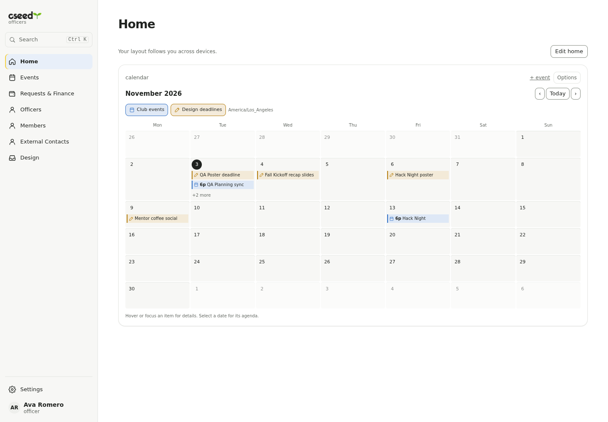 | 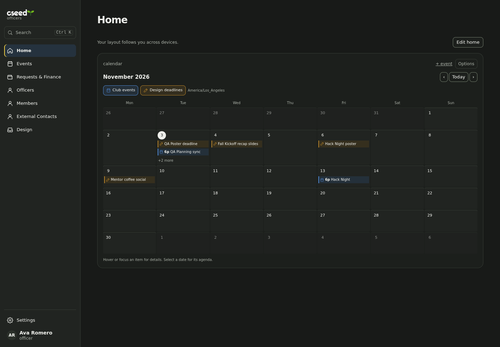 |
| 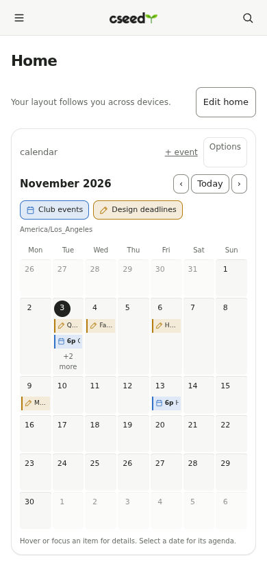 | 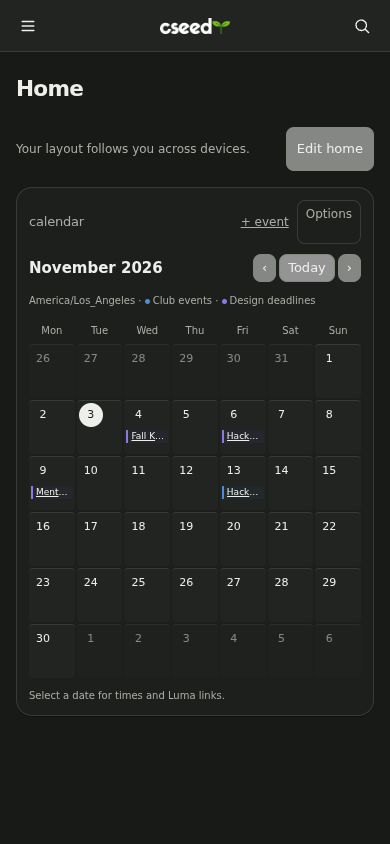 |


| Week | Small agenda |
| --- | --- |
| 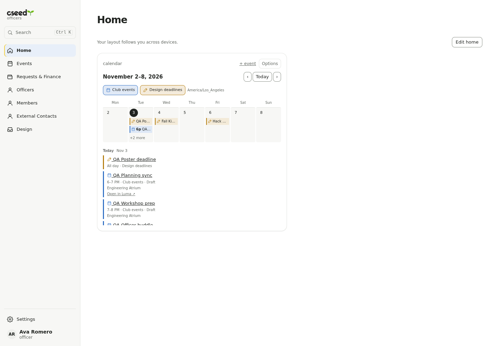 | 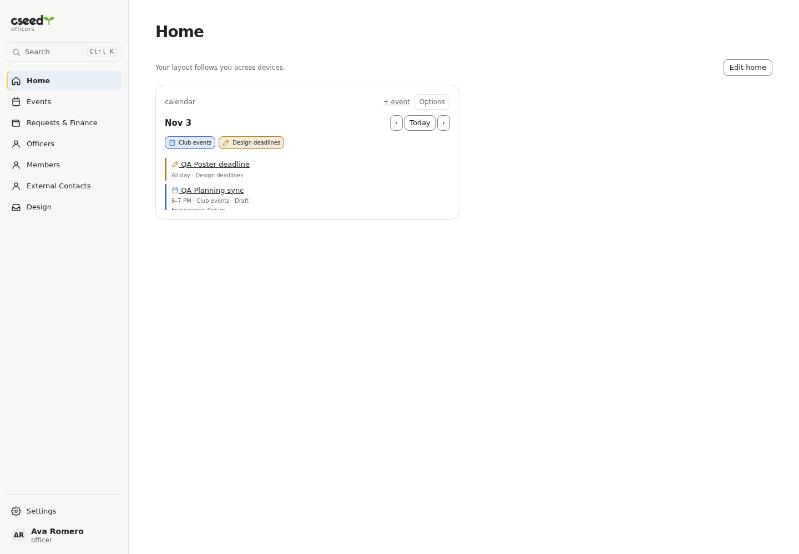 |
| 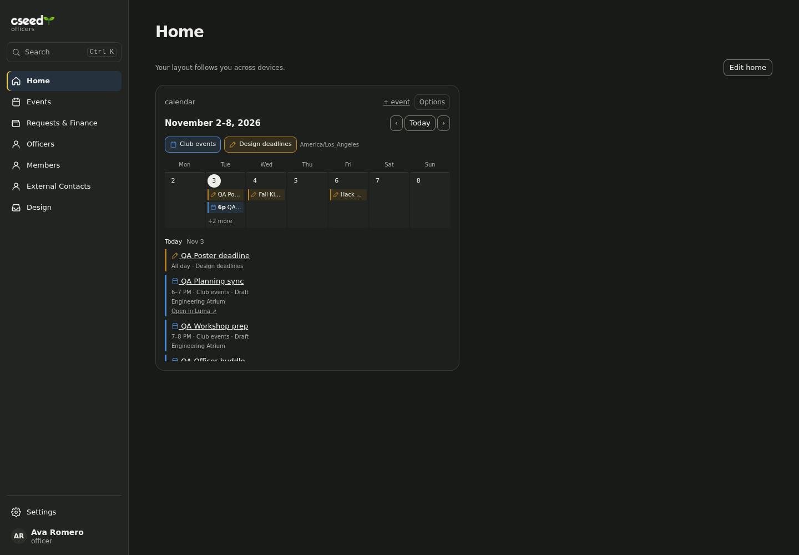 | 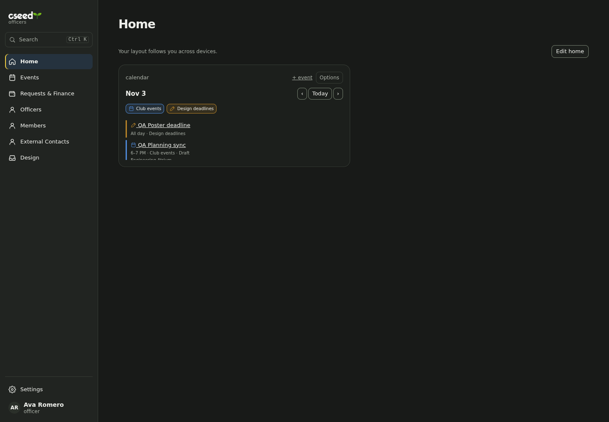 |

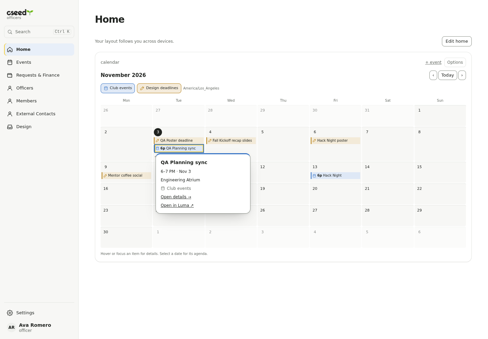

| Phone week | Phone small agenda |
| --- | --- |
| 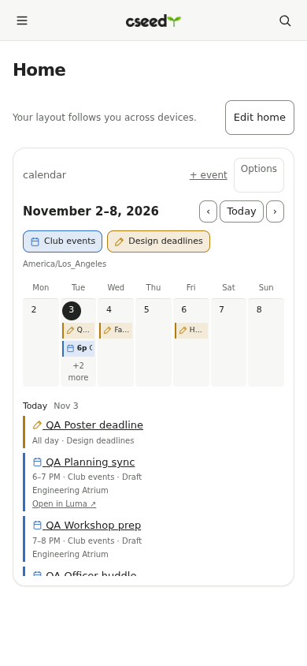 | 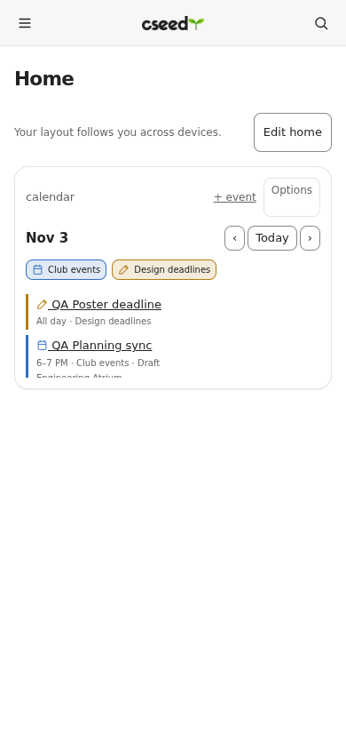 |
| 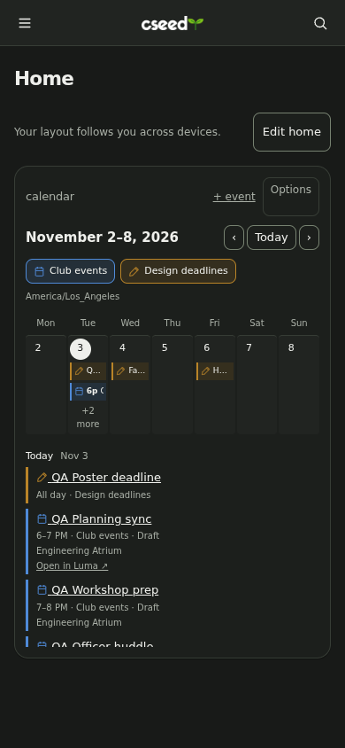 | 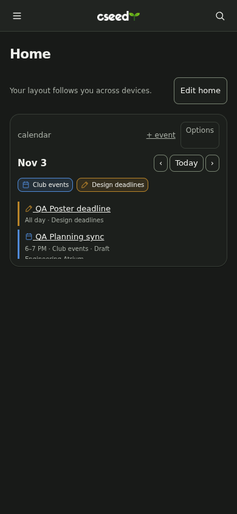 |

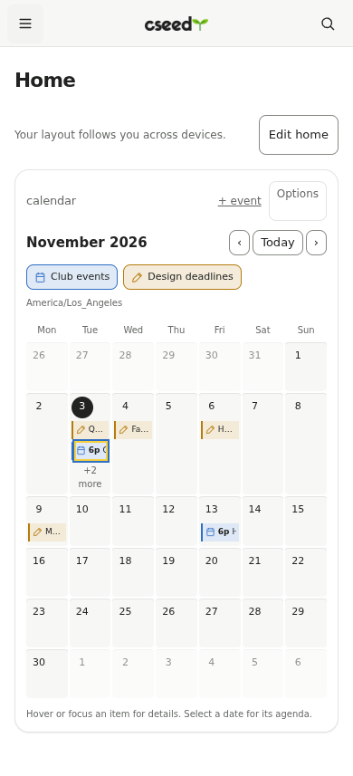

## Integrated Home layout

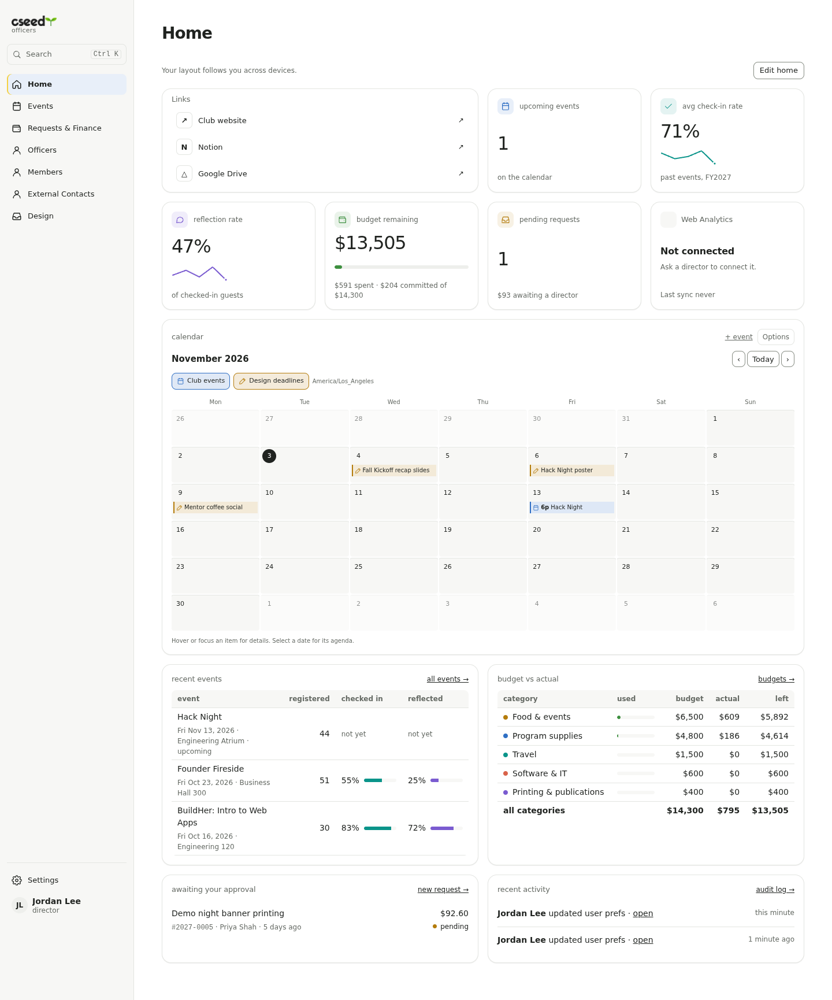

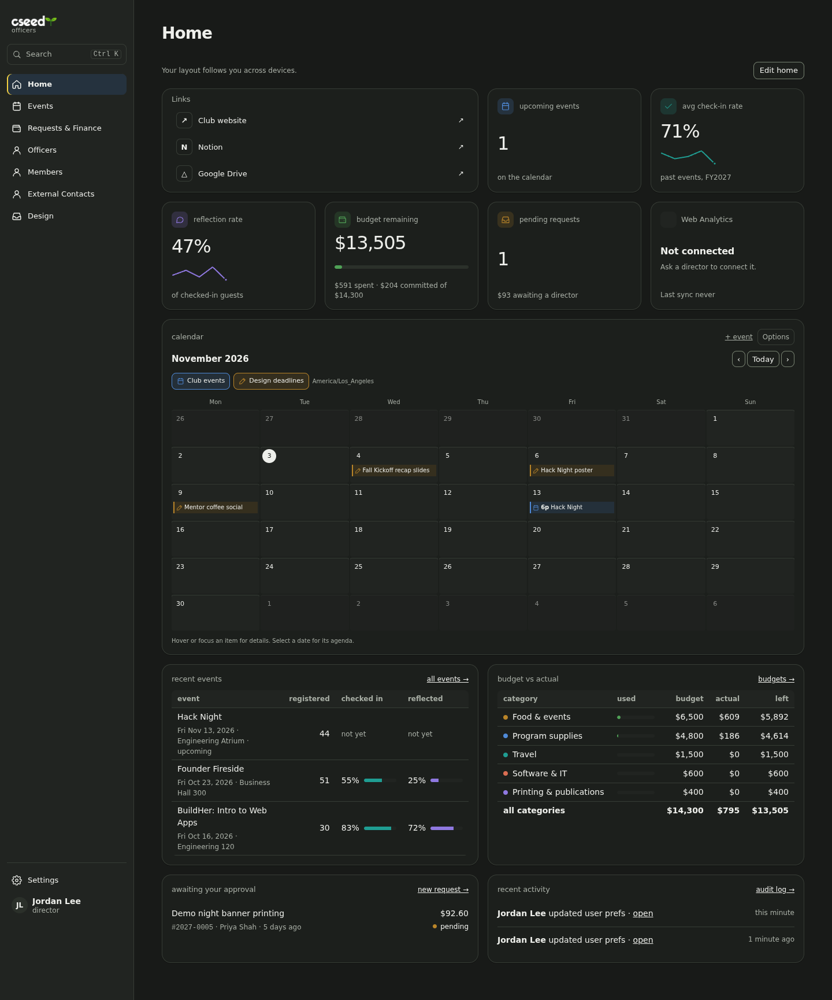

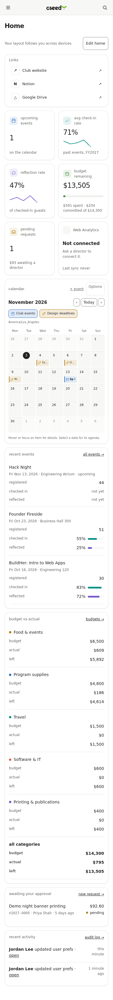
