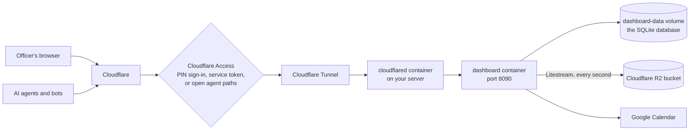

# Deploy the dashboard, step by step

> Current Free-plan image: use [Fresh install](fresh-install.md) and
> [Upgrade/restore](upgrade-existing.md). R2/Litestream commands below apply only
> to the previous image; Litestream is no longer shipped. Tunnel/Access steps remain useful.


Follow this page from top to bottom. It takes you from an empty Raspberry Pi 5 (or any 64-bit
Linux machine) to a running dashboard that officers reach at your own web address. When a step
needs a longer setup in another page, it says so, and that page sends you back here.

**Already running an older version?** Use [Upgrade](upgrade.md) instead. **Moving to a new
machine with an existing backup bucket?** See [Move to a new machine](upgrade.md#move-to-a-new-machine).

## What you'll have at the end

- The dashboard running in Docker on your server, at `https://<your-hostname>` (for example
  `https://officers.example.org`).
- No open ports on your server. Visitors reach it through a **Cloudflare Tunnel**, an outgoing
  connection from your server to Cloudflare.
- A **Cloudflare Access** sign-in in front of it: people type their email, get a one-time code
  (PIN), then sign in to the dashboard with Discord. Only emails you list get a code.
- A live copy of the database in **Cloudflare R2** (cloud file storage), updated every second by
  **Litestream** (a backup tool built into the image).
- The org Google account connected, so the dashboard keeps four shared Google calendars.



## Before you start

The dashboard is the club officers' web app: events, purchases, the officer directory, Launchpad
(the club's builder program, whose builders and mentors get their own portal) and the shared
calendars. Officers can also connect their own AI agents to it.

You need:

- [ ] **A server:** a Raspberry Pi 5 with **64-bit** Raspberry Pi OS, or any 64-bit Linux machine
  (x86 or ARM), already installed and on your network. It must stay on. A 32-bit system cannot run
  the image.
- [ ] **A network that allows outgoing connections on port 7844** (TCP and UDP), which the tunnel
  uses. Home networks allow it; some campus networks block it. Ask your network admin if unsure.
- [ ] **SSH or a keyboard** on that server, and the `sudo` password.
- [ ] **A domain name** you control (for example `example.org`), and access to the account where
  you bought it (the "registrar"), because step 2 changes its nameservers. If the domain is already
  on Cloudflare, even better.
- [ ] **A Cloudflare account** (free). Zero Trust and R2 both ask for a payment card during sign-up
  even on their free plans; this setup stays inside the free limits.
- [ ] **A Discord account** that will own the dashboard.
- [ ] **The org Gmail** (the club's own Google account) and its password, for the calendars.
- [ ] **A GitHub account**, if the dashboard image is private (step 1 tells you how to check).
- [ ] **The email address of every officer**, so they can get past the sign-in. Each officer also
  needs a Discord account, to sign in to the dashboard.
- [ ] **A password manager** to keep the secrets you collect. Several are shown only once.

**Time:** about 2 to 3 hours the first time. If your domain is new to Cloudflare, its nameserver
change can take from a few minutes up to a day. While you wait, you can do step 1, step 3, and
Cloudflare steps 2 and 9, which don't need the domain ([Cloudflare step 0](cloudflare.md#0-put-your-domain-on-cloudflare-and-open-zero-trust)
says which steps do).

**Cloudflare's Free plan** covers this setup. Its Zero Trust part allows up to 50 people to sign
in; check Cloudflare's current plans if officers, builders and mentors together are more.

**Pick your hostname now.** It is the address officers will type, a subdomain of your domain,
for example `officers.example.org`. This guide writes it as `<your-hostname>`. Replace it (and
the angle brackets) everywhere. Cloudflare's forms ask for it in two parts: the **subdomain**
(`officers`) and the **domain** (`example.org`).

### Values to save as you go

Copy this list into your password manager and fill it in. Each value is created in the step shown
and used in a later one. Values marked **secret** must never be shared or committed to git.

| Value | You get it in | It goes in |
| --- | --- | --- |
| Hostname, `<your-hostname>` | now | `.env` as `APP_URL=https://<your-hostname>` |
| Image tag, for example `0.15.0` | step 1 | `.env` as `DASHBOARD_TAG` |
| GitHub token (**secret**, only if the image is private) | step 1 | `docker login`, once |
| Tunnel token (**secret**) | step 2, [Cloudflare step 1](cloudflare.md#1-create-the-tunnel) | `.env` as `TUNNEL_TOKEN` |
| Access service token: Client ID and Client Secret (**secret**) | step 2, [Cloudflare step 5](cloudflare.md#5-create-a-service-token-for-bots) | the bots' settings, and the outside check in step 8. Not in the dashboard's files |
| Cloudflare account ID | step 2, [Cloudflare step 9](cloudflare.md#9-create-the-r2-bucket-for-backups) | `dashboard.env`, inside `LITESTREAM_ENDPOINT` |
| R2 bucket name | step 2, Cloudflare step 9 | `dashboard.env` as `LITESTREAM_BUCKET` |
| R2 Access Key ID and Secret Access Key (**secret**) | step 2, Cloudflare step 9 | `dashboard.env` as `LITESTREAM_ACCESS_KEY_ID` and `LITESTREAM_SECRET_ACCESS_KEY` |
| Discord Client ID and Client Secret (**secret**) | step 3 | `dashboard.env` as `DISCORD_CLIENT_ID` and `DISCORD_CLIENT_SECRET` |
| Your Discord user ID | step 3 | `dashboard.env` as `BOOTSTRAP_OWNER_DISCORD_ID` (and your name as `BOOTSTRAP_OWNER_NAME`) |
| Google OAuth Client ID and Client Secret (**secret**) | step 7, [Google step 1](google-calendar.md#1-create-the-google-oauth-client) | `dashboard.env` as `GOOGLE_OAUTH_CLIENT_ID` and `GOOGLE_OAUTH_CLIENT_SECRET` |

## The steps

1. [Prepare the server](#1-prepare-the-server)
2. [Set up Cloudflare](#2-set-up-cloudflare)
3. [Create the Discord app](#3-create-the-discord-app)
4. [Fill in the settings files](#4-fill-in-the-settings-files)
5. [Start the dashboard](#5-start-the-dashboard)
6. [Sign in as the owner](#6-sign-in-as-the-owner)
7. [Connect the org Google calendar](#7-connect-the-org-google-calendar)
8. [Check that it works](#8-check-that-it-works)
9. [Backups and upgrades](#9-backups-and-upgrades)

If something fails, look it up in [Troubleshooting](troubleshooting.md).

## 1. Prepare the server

Run these on the server.

1. **Check it is 64-bit.**
   ```sh
   uname -m
   ```
   You should see `aarch64` (a Pi) or `x86_64`. Anything else (such as `armv7l`) is 32-bit:
   reinstall the 64-bit OS first.

2. **Install Docker.** Raspberry Pi OS 64-bit counts as Debian here. Follow Docker's
   [Install Docker Engine on Debian](https://docs.docker.com/engine/install/debian/), section
   **Install using the `apt` repository**. (Docker's separate "Raspberry Pi OS" page is for
   32-bit systems only.) Then check:
   ```sh
   docker compose version
   ```
   You should see `Docker Compose version v2…`.

3. **Let your user run Docker without `sudo`.**
   ```sh
   sudo usermod -aG docker $USER
   ```
   Log out and log back in, then run `docker run --rm hello-world`. You should see
   `Hello from Docker!` (`permission denied` means the new group isn't active yet: log out fully,
   or reboot). Membership of the `docker` group is as powerful as `sudo`, so only add people who
   run the server.

4. **Download the deploy files.** The server only needs this repository for its settings files;
   the dashboard itself comes as a ready-made image. The repository is public, so no sign-in is
   needed.
   ```sh
   sudo apt install -y git
   cd ~
   git clone https://github.com/cseed-org/officer-dashboard.git
   cd officer-dashboard
   ```
   You should see a new `officer-dashboard` folder. Every later command runs in
   `~/officer-dashboard/server/deploy` unless a step says otherwise.

5. **Check whether the image is private.** The image is the packaged dashboard. GitHub builds it
   automatically and lists its versions on the
   [package page](https://github.com/cseed-org/officer-dashboard/pkgs/container/officer-dashboard).
   The image has its own visibility setting, separate from the repository's, so check it. Open
   that page in a private browser window, where you are not signed in to GitHub:
   - You see the page: the image is **public**. Skip to item 7.
   - You get a 404: either it is **private** or nothing has been published yet. Do item 6, then
     item 7 tells the two apart.

6. **Sign in to GitHub's image registry** (private image only). `cseed-org` is the club's GitHub
   organisation. You need a GitHub account in it that can see the package page while signed in;
   if yours can't, ask one of the organisation's owners (on GitHub: `cseed-org` → **People**) to
   add you.
   1. On GitHub, signed in as that account: your picture → **Settings** → **Developer settings** →
      **Personal access tokens** → **Tokens (classic)** → **Generate new token (classic)**. Tick
      only **`read:packages`**. Choose an expiry and note the date. **Generate token** and copy it.
      (GitHub's registry does not accept the newer "fine-grained" tokens.) If the token list then
      shows **Configure SSO** next to it, choose it and **Authorize** for `cseed-org`.
   2. On the server, with that account's GitHub username:
      ```sh
      read -rs GHCR_TOKEN        # paste the token and press Enter; nothing is shown
      printf %s "$GHCR_TOKEN" | docker login ghcr.io -u <github-username> --password-stdin
      unset GHCR_TOKEN
      ```
      You should see `Login Succeeded`.

   Docker stores this login in `~/.docker/config.json` without encryption, which is why the token
   may only read packages. The running dashboard keeps working when the token expires; only the
   next download fails, with `denied`, until you log in again. The token belongs to the person
   who made it: if they leave the club, log in again with someone else's. Making the package
   public removes this step; that is a decision for the GitHub organisation's owners.

7. **Choose the image tag.** Open the package page again (signed in, if it is private). It lists
   the image's versions, newest first, and each version shows its tags side by side:
   - If a version has the tag **`0.15.0`**, use it. That is the V0.15 release.
   - If not (the release tag `v0.15.0` has not been pushed yet), find the version tagged
     **`main`**. The same version also has a tag `sha-` followed by 7 letters and digits. Use that
     `sha-` tag: it never changes. (This guide writes it as `sha-1a2b3c4`; yours differs.)
   - If even signed in you get a 404, no image has been published yet. Ask someone who maintains
     the repository (anyone with write access) to merge to `main` or push the `v0.15.0` tag
     ([how](upgrade.md#for-maintainers-publish-a-release)), and wait about 15 minutes for GitHub to
     build it.

   Write the tag down. Don't use `latest`, `0.15` or `main`: those move to newer versions on
   their own, and a later download would then upgrade the dashboard and change its database
   without the backup the [upgrade steps](upgrade.md) take first.

8. **Check out the matching deploy files**, so they fit the image. Run one of these in
   `~/officer-dashboard`:
   ```sh
   git checkout v0.15.0          # for 0.15.0
   git checkout 1a2b3c4          # for sha-1a2b3c4: the 7 characters after "sha-"
   ```
   You should see `HEAD is now at …`. Git also prints a note about a "detached HEAD": that is
   normal, it means you are on a fixed version rather than a branch. `pathspec … did not match`
   means a typo, or a version newer than your copy: run `git fetch origin --tags` and try again.
   Then check that `ls -a server/deploy` lists `compose.cloudflare.yml`, `.env.example` and
   `dashboard.env.example`.

## 2. Set up Cloudflare

Do **[Cloudflare setup](cloudflare.md)**, steps 0 to 9, then come back here. Do all of them, even
if nobody uses AI agents or bots yet: steps 4 to 8 keep those working when someone connects one,
and the check in step 8 tests them.

You come back with the values the [table above](#values-to-save-as-you-go) lists for step 2, and
your own email in the `Officers` group.

## 3. Create the Discord app

Officers sign in to the dashboard with Discord, so the dashboard needs its own Discord
"application". (Not verified here: Discord's menu names can change.)

1. Go to the [Discord Developer Portal](https://discord.com/developers/applications) →
   **New Application**. Name it (for example `CSEED Officer Dashboard`), accept the terms,
   **Create**.
2. Open **OAuth2**. Under **Redirects**, **Add Redirect**:
   ```
   https://<your-hostname>/auth/callback
   ```
   **Save Changes**. It must match exactly: `https`, your hostname, no slash at the end. You should
   see it listed under **Redirects** after saving.
3. On the same page, copy the **Client ID**. Then **Reset Secret** and copy the **Client
   Secret**. Save both.
4. **Your Discord user ID:** in the Discord app, **User Settings** → **Advanced** → turn on
   **Developer Mode**. Then right-click your own name (in a server's member list or a message) →
   **Copy User ID**. Save it.

You should now have the Discord Client ID, the Client Secret and your user ID, a number of 17 to
20 digits.

Optional, for invitation DMs: **Bot** → **Reset Token** gives a bot token for
`DISCORD_BOT_TOKEN`. Without it, the dashboard shows invite links you copy and send yourself.

## 4. Fill in the settings files

There are two files, both in `server/deploy`, both private:

- `.env` tells Docker *what* to run: your hostname, the tunnel token and the image tag.
- `dashboard.env` holds the dashboard's own settings: Discord, backups and the rest.

1. Create them from the examples, and make them readable only by you:
   ```sh
   cd ~/officer-dashboard/server/deploy
   cp .env.example .env
   cp dashboard.env.example dashboard.env
   chmod 600 .env dashboard.env
   ```

2. Edit `.env` (for example `nano .env`; save with Ctrl+O, Enter, exit with Ctrl+X). Set these
   three lines:
   ```sh
   APP_URL=https://<your-hostname>
   TUNNEL_TOKEN=<tunnel token>
   DASHBOARD_TAG=<image tag from step 1, for example 0.15.0 or sha-1a2b3c4>
   ```
   Leave the other lines as they are.

3. Edit `dashboard.env`. Fill in Discord and the owner:
   ```sh
   DISCORD_CLIENT_ID=<Discord Client ID>
   DISCORD_CLIENT_SECRET=<Discord Client Secret>
   BOOTSTRAP_OWNER_DISCORD_ID=<your Discord user ID>
   BOOTSTRAP_OWNER_NAME=<your name>
   ```

4. In the same file, find the six `#LITESTREAM_` lines under the `Containers` heading. Remove the
   `#` from each and fill them in with your values (the example's `cseed-dashboard-db` is only a
   sample name):
   ```sh
   LITESTREAM_BUCKET=<R2 bucket name>
   LITESTREAM_ENDPOINT=https://<account ID>.r2.cloudflarestorage.com
   LITESTREAM_REGION=auto
   LITESTREAM_PATH=dashboard
   LITESTREAM_ACCESS_KEY_ID=<R2 Access Key ID>
   LITESTREAM_SECRET_ACCESS_KEY=<R2 Secret Access Key>
   ```
   Set all six, including `REGION` and `PATH`: the backup checks later read them directly.

5. Leave everything else as it is. Empty lines are fine: each one is a feature you can turn on
   later. In particular:
   - The `APP_URL` line at the top of `dashboard.env` doesn't matter: the one in `.env` wins.
   - You add the two `GOOGLE_OAUTH_` lines in step 7.
   - Optional: receipts in Google Drive (`GOOGLE_SERVICE_ACCOUNT_JSON`, `DRIVE_ROOT_FOLDER_ID`;
     while empty, officers can't upload receipts to purchases), Discord channel notifications
     (`DISCORD_WEBHOOK_URL`) and email invites (`SMTP_*`). See the
     [settings reference](../configuration.md) when you want them.

6. Check that Docker reads the files:
   ```sh
   docker compose -f compose.cloudflare.yml config --images
   ```
   You should see two lines: `ghcr.io/cseed-org/officer-dashboard:<your tag>` and
   `cloudflare/cloudflared:…`. An error naming `APP_URL`, `TUNNEL_TOKEN` or `DASHBOARD_TAG` means
   that line in `.env` is missing or empty.

## 5. Start the dashboard

1. Download the images:
   ```sh
   docker compose -f compose.cloudflare.yml pull
   ```
   You should see both images `Pulled`. `denied` means the GitHub login from step 1 is missing
   or wrong; `manifest unknown` means the tag is wrong. See [Troubleshooting](troubleshooting.md#the-download-fails).

2. Start it:
   ```sh
   docker compose -f compose.cloudflare.yml up -d
   ```
   On first start, the dashboard creates its database and sets it up. Litestream finds the R2
   bucket empty and starts copying the new database into it.

3. Check, and repeat every 15 seconds or so for up to 2 minutes:
   ```sh
   docker compose -f compose.cloudflare.yml ps
   ```
   You should see `dashboard` as `(healthy)` and `cloudflared` as `Up`. `cloudflared` only
   starts once the dashboard is healthy, so at first it may be missing or say `Created`.

4. Check that the tunnel connected:
   ```sh
   docker compose -f compose.cloudflare.yml logs cloudflared | grep "Registered tunnel connection"
   ```
   You should see a few lines. In Cloudflare (**Zero Trust** → **Networking** → **Tunnels**), the
   tunnel now shows **Healthy**.

Both containers start again on their own after a reboot or power cut, as long as Docker runs
(Docker's install turns that on). Don't run `dashboard seed` on this server: it fills the
database with made-up sample data, and sample accounting entries can't be deleted.

## 6. Sign in as the owner

Because you set `BOOTSTRAP_OWNER_DISCORD_ID`, your Discord account became the dashboard's
**owner** on first start (full access, including leadership).

1. Open `https://<your-hostname>`. Cloudflare asks for your email. Enter the one you put in the
   `Officers` group, then the PIN it emails you.
2. Choose **Sign in with Discord** and approve. You should land in the dashboard.
3. Open **Officers → Access**. You should see yourself as owner.
4. Still in **Officers → Access**, set your **account email**. Use a Google account: the shared
   calendars are shared with this address.
5. Add the other officers. For each one, **first** add their email to the `Officers` group in
   Cloudflare ([how](cloudflare.md#adding-someone-later)): they can't reach the dashboard before
   that. Then either:
   - **Officers → Access** → add an officer, with their Discord user ID (send them the
     instructions in step 3, item 4), name and role. Roles rank `officer`, then `director`, then
     `leadership`; pick `officer` unless they run a team or the club
     ([what each can do](../roles-and-permissions.md#permission-matrix)). You should see them in
     the list, and they can sign in right away at `https://<your-hostname>`.
   - Or **Officers → Invites** → **Invite officer**. The dashboard sends the invite as a Discord DM
     (needs `DISCORD_BOT_TOKEN`) or gives you a link to send yourself. Invites expire after 7
     days, and only the matching Discord account can accept.

   Each new officer then sets up their profile at first sign-in. Set their **account email** in
   **Officers → Access** too (see the table below); without it they get no shared calendars.
   Launchpad builders and mentors are invited separately, from **Buildspace + Launchpad**, after
   their email is in the `Launchpad` group ([Launchpad invites](../launchpad-cohorts.md#invite--bind--session)).

**Three emails, one person.** Discord gives the dashboard no email, so up to three addresses are
involved. Using the same one for all three is simplest.

| Email | Set in | Used for |
| --- | --- | --- |
| Sign-in email | Cloudflare, `Officers` group | getting the PIN |
| Account email | dashboard, **Officers → Access** | calendar sharing and invites; must be a Google account |
| Contact email | the person's own profile | contact details only |

If you land on the dashboard without owner access, the Discord ID was wrong. Fix
`BOOTSTRAP_OWNER_DISCORD_ID` in `dashboard.env` and run `docker compose -f compose.cloudflare.yml up -d`.
It applies while the dashboard has no owner. For an account that already exists, see
[Roles and permissions](../roles-and-permissions.md#dashboard-ownership-and-recovery).

## 7. Connect the org Google calendar

Do **[Google calendar setup](google-calendar.md)**, then come back here.

You come back with: the Google OAuth client in `dashboard.env`, the org Gmail connected, and the
four calendars shared with the officers.

## 8. Check that it works

Run these in `~/officer-dashboard/server/deploy`.

1. **Healthy:**
   ```sh
   docker compose -f compose.cloudflare.yml ps
   ```
   You should see `dashboard` as `(healthy)`.

2. **Database ready:**
   ```sh
   docker compose -f compose.cloudflare.yml exec dashboard /app/dashboard migrate
   ```
   You should see `/data/dashboard.db: 37 migrations applied` (the count for V0.15).

3. **Version:**
   ```sh
   docker compose -f compose.cloudflare.yml exec dashboard /app/dashboard version
   ```
   You should see `v0.15.0`, or the 7 characters of your `sha-` tag.

4. **Backup copy is live:**
   ```sh
   docker compose -f compose.cloudflare.yml exec dashboard litestream generations -config /etc/litestream.yml /data/dashboard.db
   ```
   You should see one row whose end time is a moment ago. In Cloudflare, your R2 bucket shows
   files under `dashboard/generations/`.

5. **No unexpected errors:**
   ```sh
   docker compose -f compose.cloudflare.yml logs dashboard | grep -v level=INFO
   ```
   You should see only "not configured" warnings for features you left off (for example SMTP or
   receipts), and Litestream's own status lines, which mention `litestream`, `replicating` or
   `snapshot`. Anything with `level=ERROR` or `fatal` needs a look in
   [Troubleshooting](troubleshooting.md).

6. **From the outside:** do [Cloudflare step 10, Check it from outside](cloudflare.md#10-check-it-from-outside),
   then come back here. You should end with `0 failed`.

7. **As a person:** sign in from your phone (not on your home Wi-Fi), open Events and Home. You
   should see the dashboard.

## 9. Backups and upgrades

**Your backup is already running.** Litestream copies every change to R2 within about a second
and keeps 72 hours of history. If the server dies, a new one restores from R2 on its first start
([Move to a new machine](upgrade.md#move-to-a-new-machine)).

**Test a restore once now**, so you know it works before you need it. This restores the R2 copy
into a temporary file inside a throwaway container; it does not touch the running database:

```sh
docker compose -f compose.cloudflare.yml run --rm --no-deps --entrypoint sh dashboard -c '
  litestream restore -config /etc/litestream.yml -o /tmp/check.db /data/dashboard.db &&
  DB_PATH=/tmp/check.db /app/dashboard migrate'
```

You should see `/tmp/check.db: 37 migrations applied` (the same count as in step 8). An error here means the backup is not
usable: check the six `LITESTREAM_` lines and the R2 key.

**To upgrade later**, follow [Upgrade](upgrade.md): back up, choose the new tag, download, start,
check. Read its rollback section before you need it: you can't go back to an older version just
by changing the tag.

**Rules that protect your data:**

- **Only one dashboard per database.** Never start a second copy (on a laptop, another server, or
  a second `docker compose up` elsewhere) with the same R2 bucket and `LITESTREAM_PATH`. Two
  copies writing at once corrupt the backup.
- **Never `docker compose run` the dashboard without `--entrypoint`.** Without it, the command
  starts a second dashboard and a second Litestream on the same data. Every command in these docs
  that uses `run` sets `--entrypoint`.
- **Don't copy `dashboard.db` by hand while it runs.** Recent changes live in a side file
  (`dashboard.db-wal`), so the copy would be incomplete. Use Litestream or the upgrade backup.
- **Keep `GOOGLE_OAUTH_CLIENT_SECRET` the same.** It also locks the stored Google connections;
  changing it means connecting the org account and every officer's Google again.

You're done. For other ways to run the dashboard (without Docker, building the image yourself, a
practice run with no Cloudflare account), see [Other setups](other-setups.md).
