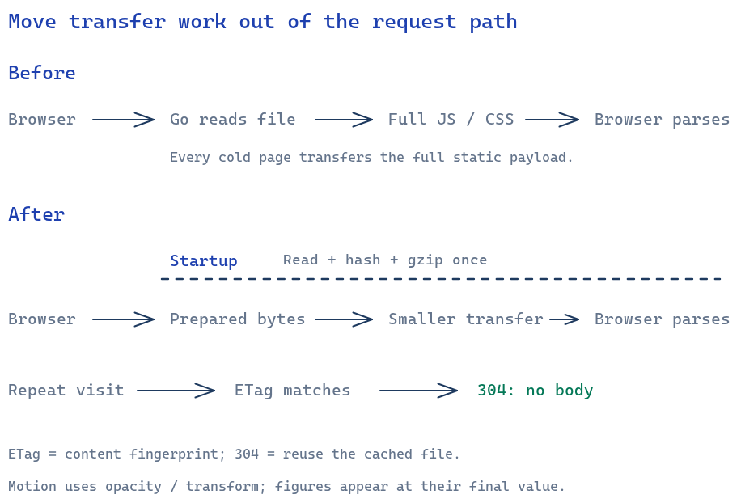

# V0.5 motion and performance draft

This slice makes navigation, content arrival, and modal dismissal consistent while reducing static transfer cost on the Raspberry Pi. It preserves full-page navigation and the existing authentication/island lifecycle. Home drag/resize and Buildspace internals are outside this change.



## Changes

- Shared durations (120/180/240ms), easing, entry distance, drawer distance, and 16ms stagger tokens. Table entry fades cap stagger at five rows; asynchronous content fades in. Existing tab underline, toast, press, drawer and dialog entry motion is reused.
- Native cross-document view transitions progressively enhance navigation. Supporting browsers animate native dialog dismissal using discrete `display`/`overlay` transitions; older browsers close immediately. Reduced motion disables the new animations/transitions, including view-transition pseudo-elements. Focus and Escape remain owned by native dialogs.
- KPI values render immediately instead of updating Preact state on every animation frame for 600ms. This avoids transient numbers and repeated text layout. Skeleton shimmer no longer uses a blur filter.
- Static HTML/CSS/JS/SVG/JSON up to 2MiB per file are read, fingerprinted and gzip-compressed once at handler startup. Requests negotiate gzip, keep the existing cache policy, and use weak content ETags for 304 responses. Byte ranges use identity bytes. API/session data is excluded. Compression costs startup time and memory rather than request CPU; there is no Brotli dependency.
- Files changed after startup fall back to live disk reads when size or modification time differs. Restart after a production rebuild to prepare the new compressed cache. HTML remains `no-cache`; hashed Astro assets remain immutable for one year.

## Measurement

Run the built Astro site through the Go server, using a disposable seeded database and dev-only director login. The repeatable Playwright probe is `web/scripts/performance.mjs`:

```sh
# From web/, after starting the seeded Go dev binary on a free local port:
WEB_ORIGIN=http://127.0.0.1:18135 PERF_SHOTS=0 \
  PERF_OUT=tmp/verify/motion node scripts/performance.mjs
# Omit PERF_SHOTS=0 to capture all six pages at 1440px/390px, light/dark.
```

Profile: Chromium headless, 1440×900, 4× CPU slowdown, 40ms network latency, 1.6Mbit/s down / 750Kbit/s up, on the Raspberry Pi host. Authentication is established through the request context before navigation so the browser starts cold. Each page uses a fresh browser context. One sample per page; results are directional, not statistical proof of budgets. This host plus 4× slowdown is not a calibrated mid-tier phone.

The probe records LCP and layout shifts before opening/closing Search. The interaction column is the maximum observed Event Timing duration for that small scripted interaction, **not field INP**. CLS is the sum of non-input shifts over this short observation window; it does not implement long-session CLS windows. JavaScript bytes are encoded response bodies (transfer size), excluding HTTP headers. No targets are claimed from skipped/unsupported metrics.

| Page | LCP before → after | CLS before → after | Interaction before → after | JS bytes before → after |
| --- | ---: | ---: | ---: | ---: |
| / | 1.33s → 1.97s | 0.0005 → 0.0719 | 224ms → 128ms | 201,728 → 74,857 |
| /events | 1.20s → 1.96s | 0.0005 → 0.0005 | 200ms → 136ms | 224,840 → 83,627 |
| /members | 1.29s → 1.64s | 0.0005 → 0.0005 | 256ms → 64ms | 180,102 → 66,212 |
| /finance | 1.54s → 0.51s | 0.0005 → 0.0005 | 216ms → 120ms | 237,913 → 86,707 |
| /design | 1.31s → 0.57s | 0.0005 → 0.0005 | 912ms → 136ms | 222,625 → 82,624 |
| /officers | 1.36s → 0.56s | 0.0005 → 0.0005 | 312ms → 184ms | 270,049 → 100,272 |

Raw [before](evidence/motion-perf/before.json) and [after](evidence/motion-perf/after.json).

## Server results

`BENCH_LATENCY=1 go test -count=1 -run LatencyReport -v ./internal/api` runs 2,000 authenticated requests per endpoint through session lookup, SQL and JSON using the seeded test harness. It is in-process, not an HTTP load test. The existing repeatable benchmark now also includes Members; use `go test -run '^$' -bench BenchmarkReadEndpoints -benchmem ./internal/api` for allocations.

| Endpoint | Before p95 | After p95 |
| --- | ---: | ---: |
| Home `/api/overview` | 13.39ms | 10.19ms |
| Events `/api/events` | 7.43ms | 2.13ms |
| Members `/api/members` | Not sampled | 2.67ms |
| Finance `/api/requests?scope=all` | 4.28ms | 0.63ms |
| Finance `/api/finance/summary` | 6.09ms | 1.14ms |

All sampled API p95 values are below 100ms. Query code is unchanged; timing differences reflect host load, not a claimed SQL speedup. Raw reports: [before](evidence/motion-perf/api-before.txt), [after](evidence/motion-perf/api-after.txt). The small seed has six events and six purchase requests; Members may be disconnected/empty. These results do not establish large-directory scaling.

Query review: purchase lists load their reference catalog once outside the item loop; event metrics aggregate by event; Members uses count plus paginated reads. Existing indexes cover member join-date ordering and campus/grad-year filters, purchase requester/status, and event/email lookups. No speculative migration was added for the small seed. Larger connected-members and concurrent HTTP measurements remain follow-up work.

## Client audit and remaining work

Page islands are already separate Astro chunks, with small SVG charts rather than an external charting library. Auth-gated page islands, UserChip and Search use `client:load`; deferring them would delay required navigation/auth controls. Fonts use the system stack and logos have explicit dimensions. The shared contract/Zod runtime is a significant common payload; this slice preserves validation rather than removing it to reduce bytes.

The authentication gate waits for `/api/me`, then timezone initialization, before page data fetches. This preserves correct timezone display but creates a fetch chain worth profiling separately. Finance and Officers still eagerly import their secondary views; splitting those views is a potential next optimization. Do not interpret gzip transfer reductions as equivalent reductions in JavaScript parse work.

Home CLS is 0.072 in the corrected after run versus 0.0005 before; an earlier browser-login baseline also observed 0.071. This timing-dependent shift is unresolved, and this draft does not meet the Home CLS target. Loading/grid stability should be checked across warm and cold visits with the dashboard-ux worker, without changing its drag/resize internals here. Client budgets not met in the table remain open, including a representative-device/field INP check. True skeleton-to-content overlap is deferred: this slice fades content in rather than retaining duplicate accessible loading/content trees.

## Verification and visual evidence

Go tests (including dev-tag auth), Go vet, Astro check/build, contract check, and focused Playwright motion checks are run for this branch. Motion checks cover reduced motion, transform-only tab movement, and Escape dismissal. Static-serving tests cover decompression, ETags/304, gzip rejection, HEAD, ranges, and rebuild fallback.

Screenshots are captured from the built site, not the Astro dev server. [Events desktop light](evidence/motion-perf/events-1440-light.png), [desktop dark](evidence/motion-perf/events-1440-dark.png), [phone light](evidence/motion-perf/events-390-light.png), [phone dark](evidence/motion-perf/events-390-dark.png). The evidence directory includes the same four captures for Home, Members, Finance, Design and Officers. Static screenshots establish layout and theme appearance; they do not prove animation timing.
