# Purchase deadlines

A purchase request can say when it is **needed by**. The date is optional and date-only
(`YYYY-MM-DD`): it means "the last day this is useful", not a time of day.

## Where it shows

| Place | What you see |
| --- | --- |
| New request form | An optional date picker. It can't be before today. |
| Finance → requests | A **needed by** column. Open requests add *due today*, *due tomorrow*, *due in N days* or *overdue by N days*. **Sort → needed by, soonest first** lists only requests that have a date. |
| Request detail | The date and its hint. The requester can **change** or **add a date** while the request is a draft. |
| Home → My actions / latest requests | A *due in N days* or *overdue* hint on open requests due within 7 days. |
| Buildspace activity | Purchase entries linked to a finance request show the request's **needed by** date. |
| Home calendar | The **Purchase deadlines** source (wallet icon, green). See below. |

"Open" means draft, pending (submitted), approved or buying (fulfilling). Bought, paid out,
closed, denied and cancelled requests show the plain date with no urgency. The hint is text,
so it doesn't rely on colour: amber for due within 7 days, red for due today or overdue.

## Rules

- **Date-only.** "Today" is the calendar date on the officer's effective time zone
  (Settings → time zone), on both the server and the browser. Dates are never converted
  through an instant, so a deadline stays on its date in every time zone.
- **Not in the past.** Creating a request with an earlier date returns 400 with a
  `neededBy` field error. An edit that *changes* the date must also be today or later. An
  unchanged date that has since passed may stay, so you can still edit a late draft's
  other fields.
- **Who edits.** The existing request rule applies: only the requester, only while it's a
  draft (403 for others, 409 after submission). Clearing the date (`null`) is allowed.
- **Audited.** Changes are recorded in the `request.updated` audit entry's before/after
  snapshots, like every other request field.

## Calendar source

`purchase-deadlines` is registered in `store.CalendarSources`
([calendar widget](calendar-widget.md#adding-a-feed-source)). It shows:

- submitted, approved and fulfilling requests with a deadline in the range, plus
  the viewer's **own** drafts. Other officers' drafts are left out to avoid clutter.
- the title, plus `#number · amount · status` in the popover and agenda, and a link to the
  request detail (`/finance?id=…`).

Denied, cancelled, fulfilled (bought), reimbursed (paid out) and closed requests are hidden.

**Default visibility:** on for directors and leadership, off for officers. Directors approve
and buy, so deadlines are part of their work. Officers mostly care about their own requests,
which already appear in My actions. Anyone can turn it on or off from the calendar legend or
**Options**. This default applies only to accounts that haven't saved calendar options.
Accounts that saved options before this release keep their sources and can opt in. The
`DefaultRole` field on a calendar source does this and is available to other sources.

Every officer can already read every request (Finance → everyone), so the calendar shows
nothing new to anyone.

## API

- `neededBy: IsoDate | null` on `PurchaseRequestListItem` (and so on the detail),
  `PurchaseRequestCreateRequest` and `PurchaseRequestUpdateRequest`.
- `GET /api/requests?sort=deadline` (default `newest`). Uses a `YYYY-MM-DD|id` cursor.
- `CalendarFeedItem.detail` is an optional one-line summary.
- `BuildspaceActivity.purchaseNeededBy` is the linked request's date.

The `needed_by` column has existed since `0000_init`. Migration
**0018_purchase_deadline.sql** adds a partial index on `(needed_by, id)` for the calendar
range query and the deadline sort.

## Tests

- Go (`server/internal/api/purchase_deadline_test.go`): past dates rejected on the
  officer's time zone (Los Angeles vs Tokyo at the same instant), impossible dates and
  datetimes rejected, draft-only/requester-only editing, audit before/after, unchanged past
  dates allowed, deadline sort and cursor paging, calendar range boundaries (exclusive end,
  single day), status filtering, draft privacy, date stability across time zones, and
  role-based defaults.
- Playwright (`web/tests/purchase-deadline.spec.ts`, phone/tablet/desktop, light and dark):
  form validation and `min`, list hints and sort, inline edit, another officer can't edit,
  the calendar chip, popover and toggle, My actions hint, and the overdue state.
  `DEADLINE_SHOTS=1` regenerates the screenshots below. The browser clock is fixed at
  2026-11-04 (and 2026-11-08 for overdue).

## Screenshots

| | Light | Dark |
| --- | --- | --- |
| Calendar, desktop | 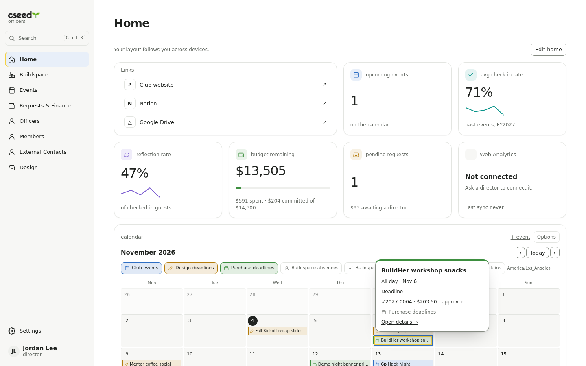 | 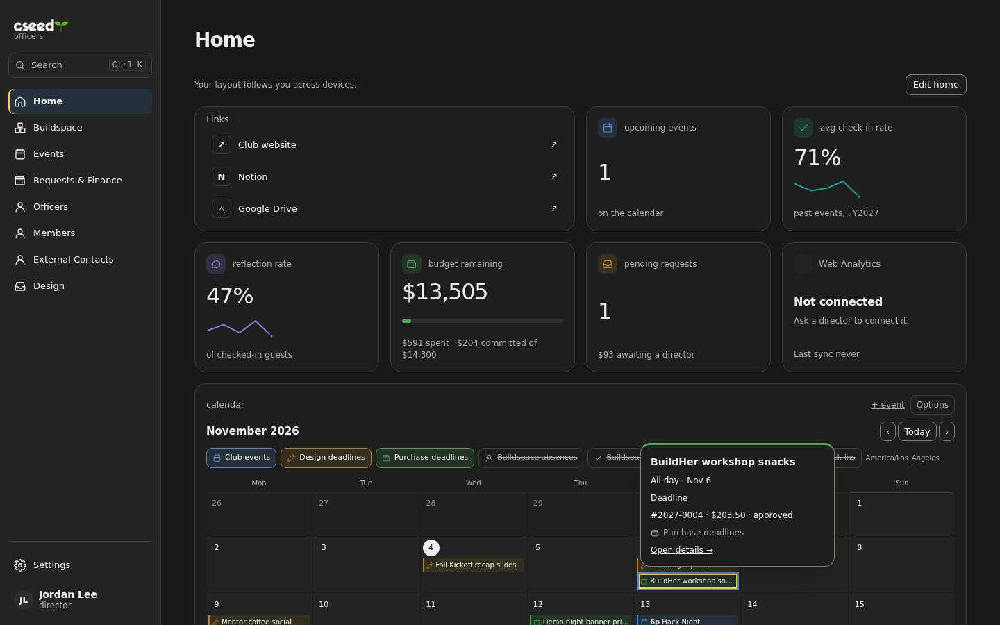 |
| Calendar, phone | 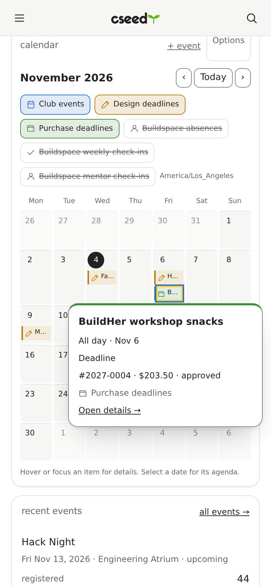 | 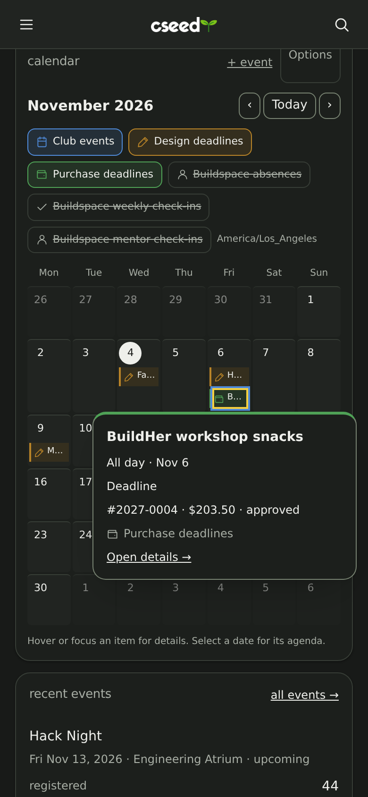 |
| Finance list, desktop | 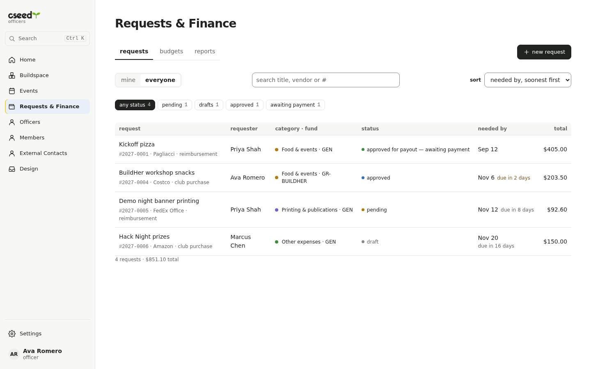 | 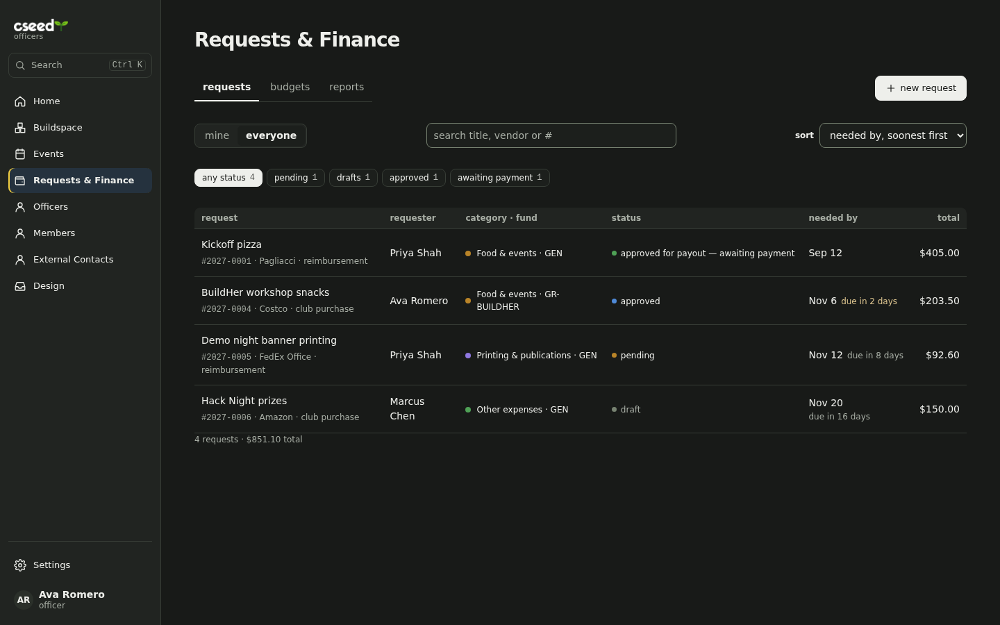 |
| Finance list, phone | 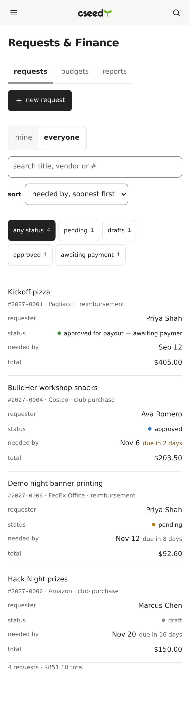 | 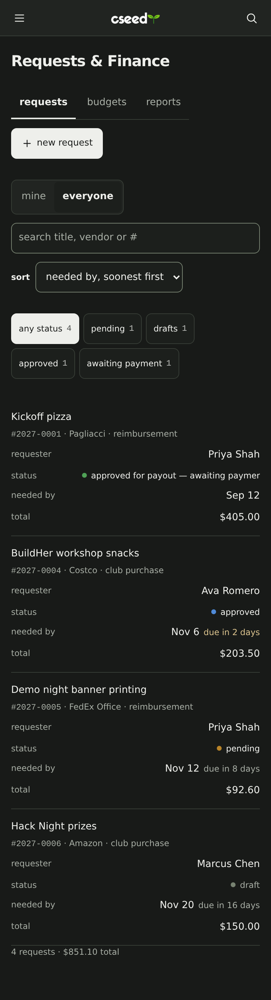 |
| Overdue, desktop | 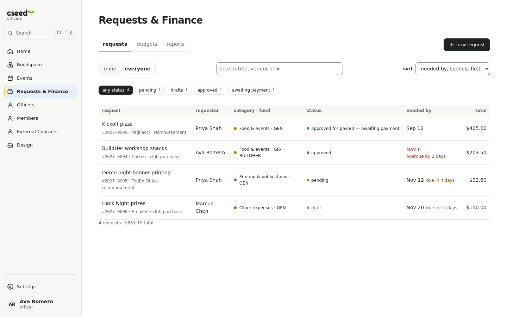 | 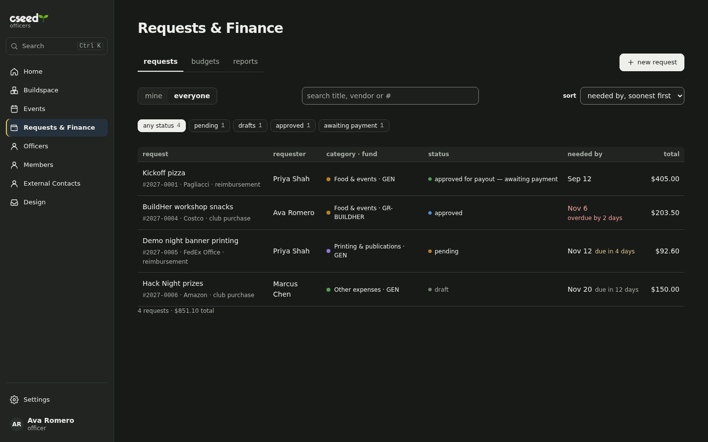 |
| Overdue, phone | 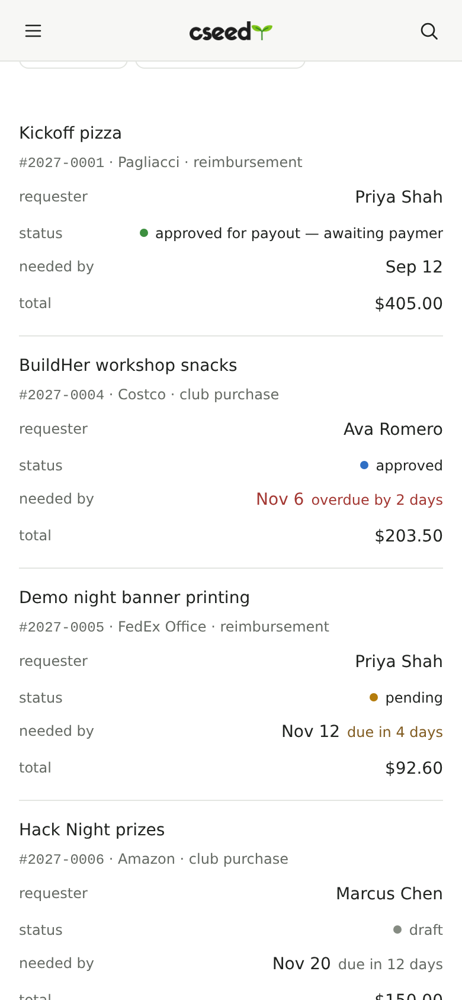 | 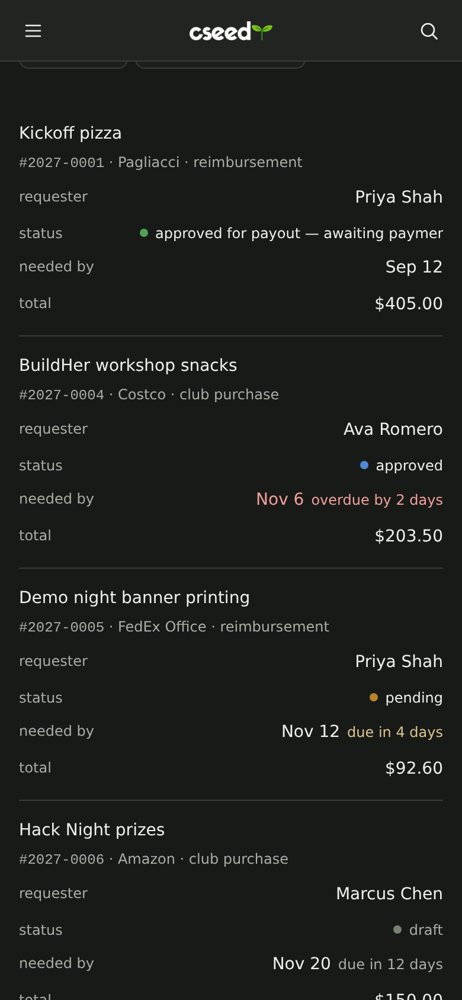 |
| Detail, desktop | 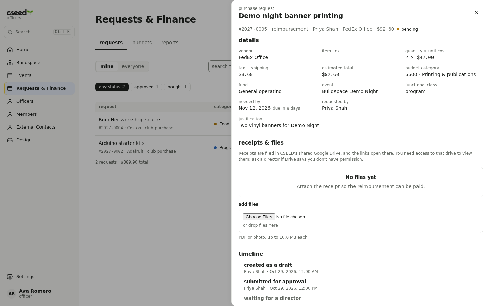 | 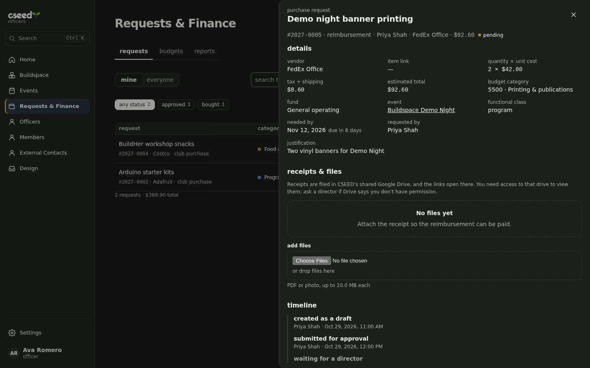 |
| Detail, phone | 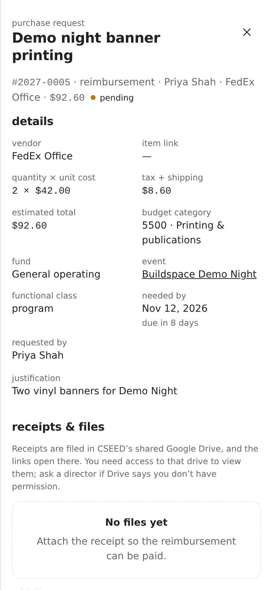 | 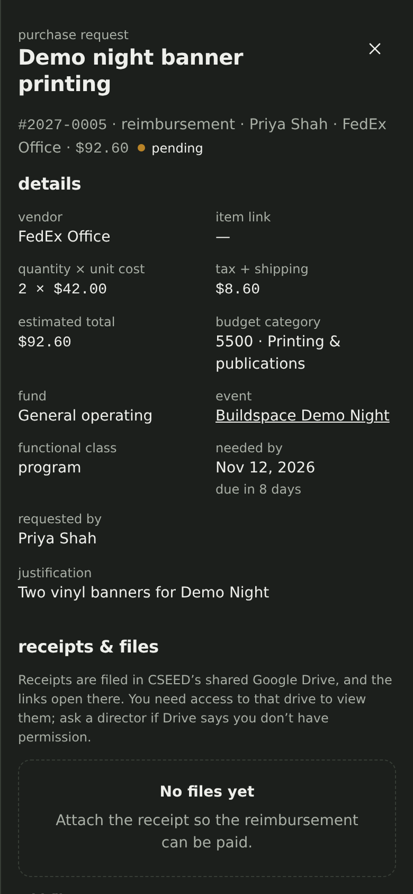 |
